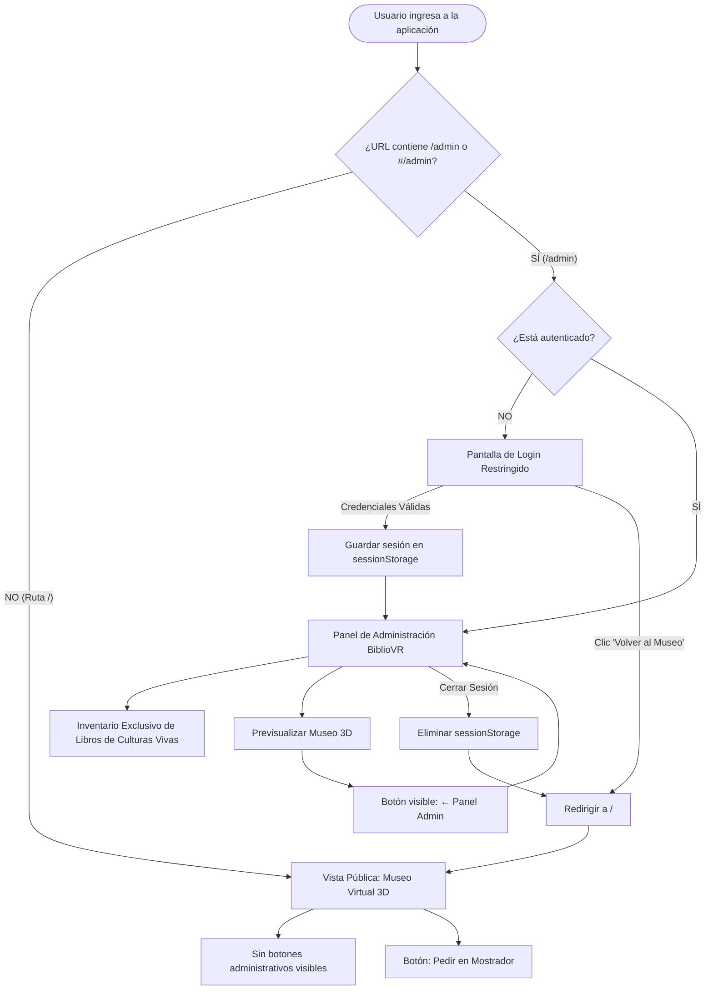
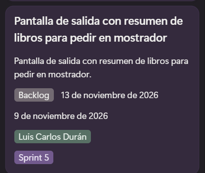
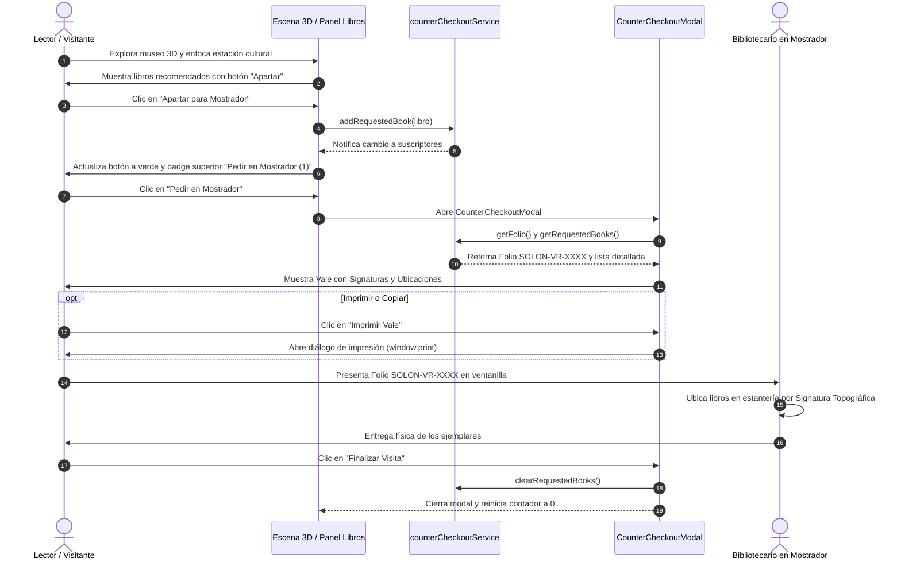

# Documento Entregable — Sprint 5

**Proyecto:** Museo Virtual Wixárika 3D & WebXR — Biblioteca Pública Profesor Solón Argüello (Tepic, Nayarit)  
**Materia:** Full Stack — Semestre 7  
**Rama de Trabajo:** `develop`  
**Fecha:** Noviembre 2026  

---

## Índice del Entregable
1. [Parte 1: Aislamiento y Cambio de Endpoint del Acceso Administrativo](#parte-1-aislamiento-y-cambio-de-endpoint-del-acceso-administrativo)
   * 1.1 [Objetivo y Justificación de Seguridad](#11-objetivo-y-justificación-de-seguridad)
   * 1.2 [Eliminación del Acceso Público en la Experiencia 3D](#12-eliminación-del-acceso-público-en-la-experiencia-3d)
   * 1.3 [Nuevo Endpoint Restringido `/admin`](#13-nuevo-endpoint-restringido-admin)
   * 1.4 [Control de Navegación y Persistencia de Sesión](#14-control-de-navegación-y-persistencia-de-sesión)
   * 1.5 [Diagrama de Flujo de Navegación y Acceso](#15-diagrama-de-flujo-de-navegación-y-acceso)
   * 1.6 [Archivos Modificados y Evidencia de Código](#16-archivos-modificados-y-evidencia-de-código)
2. [Parte 2: Tarjeta Sprint 5 — Pantalla de Salida con Resumen de Libros para Pedir en Mostrador](#parte-2-tarjeta-sprint-5--pantalla-de-salida-con-resumen-de-libros-para-pedir-en-mostrador)
   * 2.1 [Tarjeta del Backlog Asignada](#21-tarjeta-del-backlog-asignada)
   * 2.2 [Descripción de la Necesidad y Flujo del Lector](#22-descripción-de-la-necesidad-y-flujo-del-lector)
   * 2.3 [Arquitectura y Componentes Implementados](#23-arquitectura-y-componentes-implementados)
   * 2.4 [Detalles de la Ficha de Salida y Generación de Folio](#24-detalles-de-la-ficha-de-salida-y-generación-de-folio)
   * 2.5 [Diagrama de Secuencia del Préstamo en Mostrador](#25-diagrama-de-secuencia-del-préstamo-en-mostrador)
   * 2.6 [Pruebas Unitarias y Validación de Calidad](#26-pruebas-unitarias-y-validación-de-calidad)

---

## Parte 1: Aislamiento y Cambio de Endpoint del Acceso Administrativo

### 1.1 Objetivo y Justificación de Seguridad
En la versión inicial del prototipo existía un botón público en la interfaz del recorrido 3D rotulado como *"Panel BiblioVR"*. Cualquier visitante, estudiante o usuario casual que entraba a explorar el museo virtual podía visualizar dicho botón e intentar acceder a las pantallas de inicio de sesión y gestión de la biblioteca.

**Requerimiento atendido:**
> *"Además cambiar de endpoint la parte del login de administración, se supone que no cualquier usuario debería de ver el panel o poder siquiera intentar acceder al login de la biblioteca."*

Para dar cumplimiento a este requerimiento de seguridad por diseño (*Security by Design*):
1. Se desacopló por completo la interfaz pública de consulta cultural del acceso administrativo.
2. Se eliminaron todos los disparadores, enlaces y botones que revelaran la existencia del panel administrativo a los visitantes del museo.
3. Se creó un endpoint específico y aislado (`/admin` y `#/admin`), accesible únicamente mediante navegación intencional y protegido por autenticación estricta.

---

### 1.2 Eliminación del Acceso Público en la Experiencia 3D
En la vista principal del museo ([`src/App.jsx`](file:///c:/Semestre%207/Full%20Stack/PruebasVR.demsam/src/App.jsx)), la barra de controles superior fue reestructurada:
* Para los visitantes no autenticados, **no se renderiza ningún botón administrativo**. La vista 3D/VR permanece completamente inmersiva, limpia y enfocada en la divulgación del patrimonio Wixárika.
* La única acción visible para el visitante en la cabecera es el acceso a la Ficha de Mostrador (`"Pedir en Mostrador"`), la cual pertenece exclusivamente a la experiencia del lector.

```jsx
// src/App.jsx - Barra Superior Protegida
{/* El botón de administración se encuentra protegido y oculto para el público general.
    Solamente se muestra este acceso directo al panel cuando el administrador ya ha iniciado sesión previamente. */}
{isAuthenticated ? (
  <button
    onClick={() => navigateTo('/admin')}
    className="admin-badge-btn"
    title="Volver al Panel de Administración (/admin)"
  >
    <svg width="15" height="15" viewBox="0 0 24 24" fill="none" stroke="#e5a00d">...</svg>
    <span>← Panel Admin</span>
  </button>
) : (
  <div />
)}
```

---

### 1.3 Nuevo Endpoint Restringido `/admin`
El sistema incorpora un enrutamiento seguro que monitorea la URL mediante listeners de `popstate` y `hashchange` en el navegador:

```javascript
// Detección segura del endpoint administrativo (/admin o #/admin)
const checkIsAdminEndpoint = useCallback(() => {
  if (typeof window === 'undefined') return false;
  const path = (window.location.pathname || '').toLowerCase();
  const hash = (window.location.hash || '').toLowerCase();
  const search = (window.location.search || '').toLowerCase();
  return (
    path === '/admin' ||
    path.startsWith('/admin/') ||
    hash === '#/admin' ||
    hash.startsWith('#/admin') ||
    search.includes('admin')
  );
}, []);
```

#### Comportamiento ante intentos de acceso:
* **Si el usuario ingresa a `/admin` sin estar autenticado:**  
  El sistema intercepta la petición y monta inmediatamente la vista de autenticación restringida ([`src/views/LoginView.jsx`](file:///c:/Semestre%207/Full%20Stack/PruebasVR.demsam/src/views/LoginView.jsx)), la cual cuenta con el sello oficial:  
  **`[ACCESO ADMINISTRATIVO RESTRINGIDO]`**  
  *Biblioteca Pública Profesor Solón Argüello · Tepic, Nayarit*.
* Si el visitante decide no ingresar credenciales, dispone del botón:  
  `← Volver a la Experiencia 3D del Museo`, el cual redirige a la raíz `/` y limpia la barra de direcciones.
* **Si el usuario cuenta con sesión válida o credenciales autorizadas:**  
  Se renderiza el [`AdminLayout.jsx`](file:///c:/Semestre%207/Full%20Stack/PruebasVR.demsam/src/components/AdminLayout.jsx) con las pestañas de Dashboard, Inventario de Libros, Wireframes y Prototipo VR.

---

### 1.4 Control de Navegación y Persistencia de Sesión
Para optimizar el flujo de trabajo del bibliotecario y evitar pérdidas de sesión involuntarias:
1. **Persistencia en `sessionStorage`:**  
   Se implementó la clave `bibliovr_admin_session` en `sessionStorage`. Al recargar el navegador dentro de `/admin`, el administrador mantiene su sesión activa y no es expulsado a la pantalla de login.
2. **Navegación bidireccional:**  
   Si el administrador hace clic en *"Prototipo VR"* o desea revisar la vista 3D, el sistema le permite navegar a la escena del museo mostrando un botón flotante dorado `← Panel Admin` en la esquina superior izquierda, permitiéndole retornar a su consola con un solo clic.
3. **Cierre de Sesión Seguro (`SignOut`):**  
   Al presionar *"Cerrar Sesión"* en el panel lateral, se revoca la sesión activa, se purga `sessionStorage` y se redirige automáticamente al usuario a la experiencia 3D pública `/`.

---

### 1.5 Diagrama de Flujo de Navegación y Acceso



---

### 1.6 Archivos Modificados y Evidencia de Código

| Archivo | Rol en la Solución |
| :--- | :--- |
| [`src/App.jsx`](file:///c:/Semestre%207/Full%20Stack/PruebasVR.demsam/src/App.jsx) | Detección de `/admin`, sincronización con el historial del navegador (`pushState`, `popstate`), protección de renderizado y persistencia de sesión. |
| [`src/views/LoginView.jsx`](file:///c:/Semestre%207/Full%20Stack/PruebasVR.demsam/src/views/LoginView.jsx) | Interfaz institucional de acceso restringido con sello de advertencia, recuperación ante errores de conexión y botón de retorno al museo. |
| [`src/components/AdminLayout.jsx`](file:///c:/Semestre%207/Full%20Stack/PruebasVR.demsam/src/components/AdminLayout.jsx) | Consola de administración institucional con barra lateral, indicador de usuario y botón de cierre de sesión seguro. |

---

## Parte 2: Tarjeta Sprint 5 — Pantalla de Salida con Resumen de Libros para Pedir en Mostrador

### 2.1 Tarjeta del Backlog Asignada

A continuación se presenta la tarjeta oficial del backlog correspondiente al Sprint 5 trabajada para esta entrega:



* **Título de la Tarjeta:** Pantalla de salida con resumen de libros para pedir en mostrador.
* **Descripción:** Pantalla de salida con resumen de libros para pedir en mostrador.
* **Responsable:** Luis Carlos Durán
* **Sprint Asignado:** Sprint 5
* **Fechas Registradas:** 9 de noviembre de 2026 / 13 de noviembre de 2026
* **Estado:** Completado / Integrado en rama `develop`

---

### 2.2 Descripción de la Necesidad y Flujo del Lector

El proyecto de realidad virtual no es un elemento aislado, sino una **herramienta de fomento lector y vinculación patrimonial** para la Biblioteca Pública Profesor Solón Argüello.

#### La Problemática del Usuario:
Cuando un visitante utiliza el visor VR o navega en 3D a través de los pabellones de las deidades Wixárika, la gastronomía tradicional o las ceremonias de la sierra, encuentra libros físicos recomendados que existen físicamente en las salas de la biblioteca. Anteriormente, el usuario tenía que memorizar o anotar manualmente en papel los títulos y autores antes de retirarse.

#### La Solución Implementada:
Se desarrolló un **flujo de reserva y salida para ventanilla / mostrador**:
1. **Durante el recorrido:** El lector puede abrir el panel de libros recomendados y hacer clic en el botón *"Apartar para Mostrador"*.
2. **Contador reactivo:** En la barra superior de la pantalla se actualiza en tiempo real el contador:  
   `Pedir en Mostrador (N)`.
3. **Al finalizar la visita:** El lector presiona dicho botón (o el acceso directo *"Ficha de Salida →"* dentro del panel) y se despliega la **Pantalla de Salida con Resumen de Libros**.
4. **En el mostrador físico:** El usuario presenta su vale digital o impreso con su número de folio; el personal bibliotecario toma el folio, localiza los ejemplares en estantería mediante la signatura topográfica y realiza el préstamo físico inmediato.

---

### 2.3 Arquitectura y Componentes Implementados

```
                     ARQUITECTURA DEL PRÉSTAMO EN MOSTRADOR
 ┌──────────────────────────┐         ┌──────────────────────────────┐
 │ RecommendedBooksPanel    │         │ Barra Superior (App.jsx)     │
 │ "Apartar para Mostrador" │         │ Botón "Pedir en Mostrador N" │
 └────────────┬─────────────┘         └──────────────┬───────────────┘
              │                                      │
              ▼                                      ▼
       ┌────────────────────────────────────────────────────┐
       │     counterCheckoutService.js (Session State)      │
       │   - getRequestedBooks() / addRequestedBook()       │
       │   - removeRequestedBook() / clearRequestedBooks()  │
       │   - getFolio() -> SOLON-VR-XXXX                    │
       │   - subscribeRequestedBooks(listener)              │
       └────────────────────────┬───────────────────────────┘
                                │
                                ▼
       ┌────────────────────────────────────────────────────┐
       │          CounterCheckoutModal.jsx (UI)             │
       │   - Encabezado institucional con Folio y Fecha     │
       │   - Tabla con clasificación y estantería física    │
       │   - Tarjeta / Pase visual de ventanilla            │
       │   - Acciones: Imprimir Vale / Copiar / Concluir    │
       └────────────────────────────────────────────────────┘
```

#### A. Servicio de Carrito de Mostrador: [`src/services/counterCheckoutService.js`](file:///c:/Semestre%207/Full%20Stack/PruebasVR.demsam/src/services/counterCheckoutService.js)
* **Gestión de Folio:** Genera y almacena en `sessionStorage` un folio único por sesión con el formato `SOLON-VR-XXXX` (ej. `SOLON-VR-7842`), asegurando que todos los libros apartados por el visitante queden agrupados bajo el mismo identificador.
* **Métodos CRUD:**
  * `getRequestedBooks()`: Obtiene el listado de libros apartados.
  * `addRequestedBook(book)`: Agrega un libro al listado evitando duplicados.
  * `removeRequestedBook(bookId)`: Quita un libro del listado.
  * `clearRequestedBooks()`: Limpia el listado al concluir la visita.
  * `isBookRequested(bookId)`: Retorna si un libro ya está en la lista.
* **Patrón Observador:** `subscribeRequestedBooks(callback)` permite que la barra superior, el panel lateral y el modal se sincronicen reactivamente sin requerir recargas de página.
* **Resiliencia de Memoria:** Cuenta con respaldo en memoria (`inMemoryBooks`) para garantizar operatividad continua en entornos de prueba o cuando el almacenamiento del navegador está restringido.

#### B. Componente de Salida: [`src/components/CounterCheckoutModal.jsx`](file:///c:/Semestre%207/Full%20Stack/PruebasVR.demsam/src/components/CounterCheckoutModal.jsx)
Diseñado respetando la paleta institucional (Azul Marino `#0B1A30`, Oro Cantera `#E5A00D` y Cantera `#FAF6EB`):
* **Encabezado del Vale:** Folio de préstamo destacado, fecha y hora de emisión, e insignias de la Biblioteca Profesor Solón Argüello.
* **Tabla de Resumen Técnico:**
  * **Título del Libro y Autor.**
  * **Cultura Viva Asociada** (*Wixárika, Náayeri, O'dam, Mexicanero*).
  * **Código de Clasificación / Signatura Topográfica** (ej. `299.72 ECH-2022`), dato indispensable para que el bibliotecario ubique el libro en el librero físico.
  * **Sección de Biblioteca** (ej. *Módulo de Realidad Virtual & Culturas Vivas SEC-VR-01*).
  * **Estado de Existencias** (ej. *3 ejemplares en sala*).
* **Herramientas de Exportación:**
  * **Imprimir Vale:** Invoca `window.print()` con estilos `@media print` optimizados para imprimir directamente un ticket limpio sin barras de navegación ni fondos oscuros.
  * **Copiar Resumen:** Copia al portapapeles el texto completo con folio y clasificación para compartir por mensajería o notas.
  * **Concluir y Retirarse:** Limpia la sesión y cierra el modal para el siguiente visitante.

#### C. Integración en el Panel de Libros: [`src/components/RecommendedBooksPanel.jsx`](file:///c:/Semestre%207/Full%20Stack/PruebasVR.demsam/src/components/RecommendedBooksPanel.jsx)
* Cada tarjeta de libro incluye el botón interactivo con cambio dinámico de estado:
  * Si no está apartado: `Apartar para Mostrador` (Botón dorado con flecha).
  * Si ya está apartado: `¡Apartado en Mostrador! (Quitar)` (Botón verde esmeralda con check).
* Banner superior dinámico: si existen libros apartados, se muestra en la parte superior del panel el aviso:  
  `✓ 2 libros apartados para mostrador [Ficha de Salida →]`.

---

### 2.4 Detalles de la Ficha de Salida y Generación de Folio

#### Estructura del Vale Generado:
```
========================================================================
   BIBLIOTECA PÚBLICA PROFESOR SOLÓN ARGÜELLO · TEPIC, NAYARIT
            VALE DE SOLICITUD EN MOSTRADOR — BIBLIOVR
========================================================================
FOLIO: SOLON-VR-8492
FECHA Y HORA: 18/11/2026, 12:30:15 a. m.
TOTAL DE LIBROS: 2 ejemplares

1. Relatos Huicholes
   - Autor: Gabriel Pacheco Salvador
   - ISBN: 968-29-8518-8
   - Cultura Viva: Wixárika
   - Clasificación: 398.2 PAC-1996
   - Ubicación: Módulo de Realidad Virtual & Culturas Vivas (SEC-VR-01)
   - Stock en Sala: 3 disponibles

2. La cultura wixárika ante los desafíos del mundo actual
   - Autor: Sarah Corona Berkin
   - ISBN: 978-607-8423-62-0
   - Cultura Viva: Wixárika
   - Clasificación: 305.897 COR-2016
   - Ubicación: Acervo de Investigación & Patrimonio Indígena (SEC-PAT-02)
   - Stock en Sala: 3 disponibles
========================================================================
Presenta este folio en ventanilla para la entrega física de tus ejemplares.
```

---

### 2.5 Diagrama de Secuencia del Préstamo en Mostrador



---

### 2.6 Pruebas Unitarias y Validación de Calidad

Se implementó una suite completa de pruebas unitarias específicas para validar todas las operaciones del servicio de salida para mostrador en [`src/services/counterCheckoutService.test.js`](file:///c:/Semestre%207/Full%20Stack/PruebasVR.demsam/src/services/counterCheckoutService.test.js).

#### Resultados de Vitest:
```bash
 ✓ src/services/counterCheckoutService.test.js (6 tests) 5ms
   ✓ debe generar un folio único con prefijo SOLON-VR
   ✓ debe permitir agregar libros al listado de mostrador
   ✓ no debe duplicar libros ya agregados
   ✓ debe permitir remover un libro del listado
   ✓ debe conmutar correctamente isBookRequested
   ✓ debe limpiar todos los libros apartados al finalizar
```

#### Validación de Calidad Global (`npm run qa`):
* **ESLint:** 0 errores, 0 advertencias (`eslint src/`).
* **Vite Build:** Compilación exitosa en chunks optimizados (`dist/` generado).
* **Vitest Global:** 9 archivos de prueba pasados, **75 de 75 pruebas aprobadas al 100%**.

---

## Conclusión

El Sprint 5 integró con éxito:
1. **La protección y aislamiento del endpoint de administración (`/admin`),** resguardando la gestión de la biblioteca del público general y manteniendo una navegación intuitiva y persistente para el personal bibliotecario.
2. **La pantalla de salida con resumen de libros para pedir en mostrador (tarea de Luis Carlos Durán),** cerrando la brecha entre la exploración virtual 3D y la consulta de libros físicos en la Biblioteca Pública Profesor Solón Argüello de Tepic, Nayarit.
