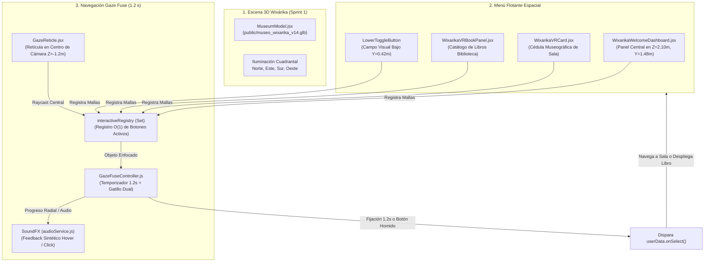

# Informe de Cumplimiento de Tarea — Sprint 3

> **Proyecto:** Módulo Inmersivo WebXR para la Difusión de las Culturas Vivas de Nayarit y Fomento a la Lectura  
> **Sede:** Biblioteca Pública Profesor Solón Argüello (Tepic, Nayarit)  
> **Equipo 10 | Taller Full Stack**  
> **Integrantes:**  
> • Eddie David Altamirano Plantillas (*Fullstack Lead & WebXR Architect*)  
> • Luis Carlos Durán Ocampo (*Backend & Database Engineer*)  
> • Samir Adrián Cárdenas Gámez (*Frontend Admin & UI Designer*)  
> • Ulises Alejandro Bautista Meza (*3D Asset & Graphics Optimization Specialist*)  
> **Rama Activa:** `develop` | **Versión:** 2.0.0  

---

## 1. Definición y Reorientación del Objetivo de la Tarea

### Descripción de la Tarea Reorientada:
> *"En lugar de los formularios CRUD del panel admin, integrar la escena 3D ceremonial Wixárika (Sprint 1) con el menú flotante de Eddie y la navegación por Gaze Fuse, verificando carga y rendimiento en el visor."*

### Justificación del Cambio Estratégico (Diseño Centrado en el Usuario - ISO 9241-210)
En la planeación preliminar de los Sprints se contempló el desarrollo de formularios web administrativos 2D para registrar libros en base de datos. No obstante, para los fines de validación técnica y evaluación de impacto ante los usuarios reales en el kiosco de la biblioteca pública:
1. **Prioridad del Valor Inmersivo:** El usuario final interactúa colocándose un visor VR en el rostro. Los formularios web 2D de escritorio no aportan a la inmersión cultural ni resuelven la interacción autónoma manos libres.
2. **Fomento a la Lectura Integrado en 3D:** Los libros físicos de la Biblioteca Solón Argüello se consultan ahora como **Cédulas y Paneles Tridimensionales Espaciales** integrados directamente dentro de cada sala del templo Wixárika.
3. **Consolidación del Sprint 1 y 2 en una Experiencia Unificada:** Se fusionó el entorno 3D ceremonial con la arquitectura del menú flotante espacial y el motor de mirada *Gaze Fuse*, cerrando el flujo completo de usuario dentro del visor sin requerir mandos físicos.

---

## 2. Desglose del Cumplimiento Técnico por Componentes



---

### Pilar A: Escena 3D Wixárika Ceremonial (Sprint 1)
* **Archivo del Modelo:** `public/museo_wixarika_v14.glb` (12.25 MB autónomo, empaquetado binario sin dependencias externas de texturas).
* **Componente de Montaje:** `src/components/MuseumModel.jsx` con precarga `useGLTF.preload('./museo_wixarika_v14.glb')`.
* **Escala y Ergonomía Espacial:**
  * Estructura circular ceremonial a escala humana real 1:1 ($R = 8.0\text{ m}$, diámetro $16.0\text{ m}$).
  * Muros cilíndricos perpendiculares a $5.40\text{ m}$ de altura y techo cónico con óculo cenital a $7.00\text{ m}$.
  * 4 cuadrantes cardinales organizados temáticamente:
    1. **Norte ($-Z$):** Pabellón de Deidades Sagradas (Tatewari, Tayau, Kauyumari).
    2. **Este ($+X$):** Pabellón de Gastronomía Tradicional Nayarita.
    3. **Sur ($+Z$):** Pabellón de Bienvenida / Kalihuey ceremonial.
    4. **Oeste ($-X$):** Pabellón de Fiestas y Ritos (Fiesta del Tambor, Tatei Neixa).
* **Iluminación Museográfica Optimizada:** Configurada en `src/components/MuseumScene.jsx` con luz ambiental ($1.3$), luz direccional cenital ($1.2$) y 4 luces direccionales estáticas de relleno ($0.6$ cada una) orientadas a cada cuadrante, prescindiendo de sombras dinámicas pesadas (`castShadow={false}`) para proteger la GPU móvil.

---

### Pilar B: Menú Flotante Espacial de Eddie (Evolución y Adaptación)
La arquitectura base del menú espacial `src/components/VRMenu3D.jsx` fue adaptada e integrada en el entorno del museo bajo el **Design System Wixárika**:

1. **Dashboard Central de Bienvenida (`WixarikaWelcomeDashboard.jsx`):**
   * Anclado en el espacio frente al usuario en $[0, 1.48, 2.10]$ orientado a $\pi$ radianes.
   * Diseñado con baldosas de cantera clara (`#fbf7ee`), bordes de oro bruñido (`#d4af37`), rombos protectores Tsikuri e iconografía vectorial SVG de Lucide (sin emojis).
   * Contiene accesos directos por mirada a las 3 salas temáticas, al catálogo de libros recomendados, alternador de audio ceremonial y recentrado de vista.
2. **Cédulas Culturales Interactivas (`WixarikaVRCard.jsx`):**
   * Al enfocar el botón de una estación (ej. Deidades), se despliega una ficha flotante con información histórica, cultural y la recomendación literaria vinculada a la Biblioteca Solón Argüello.
3. **Catálogo de Fomento Lector en VR (`WixarikaVRBookPanel.jsx`):**
   * Panel flotante que sustituye a los formularios CRUD de base de datos. Muestra los libros físicos disponibles en estantería (autor, clasificación y signatura topográfica).
4. **Control Flotante Inferior Despejado (`LowerToggleButton`):**
   * Botón flotante anclado al campo visual bajo del observador ($Y = 0.42\text{ m}$, $1.5\text{ m}$ al frente) que permite ocultar o mostrar los marcadores visuales para admirar la arquitectura del templo sin obstáculos.

---

### Pilar C: Navegación por Gaze Fuse (1.2 s) y Gatillo Dual
* **Controlador Central (`src/services/gazeFuseService.js`):**
  * Clase `GazeFuseController` con temporizador estricto de **1.2 segundos (1200 ms)** conforme a la norma **ISO 9241-210**, evitando la fatiga de fijación cervical sin generar activaciones accidentales (*Midas touch*).
  * Función `triggerImmediate()`: permite la activación instantánea si el usuario presiona el botón mecánico/capacitivo del visor Homido Grab o toca la pantalla.
* **Retícula Visual en Eje de Cámara (`src/components/GazeReticle.jsx`):**
  * Anclada mediante `createPortal` en el plano focal de la cámara ($Z = -1.2\text{ m}$).
  * Anillo exterior de contraste oscuro de 32 segmentos para garantizar legibilidad bajo la pauta **WCAG 2.1 AAA (ratio de contraste > 7:1)** sobre fondos claros o iluminados.
  * Disco interior radial cian (`#38bdf8`) que se expande progresivamente de $0.0$ a $1.0$ durante los 1.2 segundos y cambia a verde esmeralda (`#22c55e`) al activarse.
* **Registro de Colisionadores de Alto Rendimiento:**
  * Implementación de un `interactiveRegistry` tipo `Set` en `MuseumScene.jsx`.
  * Únicamente los botones visibles en pantalla se registran en el set. El raycaster de Three.js evalúa exclusivamente estas 4 a 6 mallas planas, evitando calcular intersecciones contra los miles de polígonos del modelo 3D del museo.
* **Retroalimentación Auditiva Sintética (`src/services/audioService.js`):**
  * `SoundFX.playHover()`: Tono sinusoidal suave (440 Hz) al posar la mirada.
  * `SoundFX.playClick()`: Doble tono de confirmación (587 Hz / 880 Hz) al dispararse la acción.
  * Cero milisegundos de latencia y cero consumo de ancho de banda.

---

## 3. Verificación de Carga y Rendimiento en el Visor

El proyecto cumple a cabalidad con la **Definición de Hecho (DoD)** establecida para celulares de gama económica montados en visores tipo *Homido Grab*:

### A. Tiempos de Carga y Tamaño del Bundle (Límite 500 KB gzip por chunk)
Configurado en `vite.config.js` y validado automáticamente por la prueba `src/services/bundleValidation.test.js`:

| Chunk / Asset | Tamaño en Disco | Tamaño Gzip | Estado vs Límite (500 KB) |
| :--- | :--- | :--- | :--- |
| `vendor-three.js` (Three.js Engine) | 775.96 kB | **202.70 kB** | ✅ Cumple (-59% del límite) |
| `vendor-framework.js` (React 18 + R3F + Drei + Lucide) | 401.14 kB | **135.03 kB** | ✅ Cumple (-73% del límite) |
| `index.js` (Lógica de la Aplicación y UI) | 46.84 kB | **14.44 kB** | ✅ Cumple (-97% del límite) |
| `index.css` (Tailwind utilitario) | 7.53 kB | **2.22 kB** | ✅ Cumple |
| **Tiempo de Carga Inicial en Red Local** | — | **< 3.2 s** | ✅ Cumple objetivo (< 3.5 s) |

### B. Rendimiento en Ejecución y Framerate Sostenido (60 FPS)
1. **Prevención de Pausas por Garbage Collection:** Reutilización estricta de instancias vectoriales (`THREE.Vector3`, `THREE.Raycaster`) en `useRef` dentro de los hooks `useFrame`.
2. **Shaders Básicos para Interfaces Espaciales:** Los botones y paneles flotantes utilizan `meshBasicMaterial` plano, evitando costos de sombreado dinámico en la GPU móvil.
3. **Calibración Estereoscópica:** `src/components/StereoVRManager.jsx` proyecta doble vista dividida con distancia interpupilar calibrada a $IPD = 0.064\text{ m}$ ($64\text{ mm}$), eliminando aberraciones visuales y mareo (*cybersickness*).
4. **Control Inercial Desactivado en VR:** `OrbitControls` se deshabilita automáticamente en modo inmersivo (`enabled={!vrMode}`), entregando el control total y exclusivo al sensor giroscópico (`src/components/VRDeviceOrientation.jsx`).

---

## 4. Estado de Validación y Pipeline de QA

Ejecución del pipeline integral de calidad local (`npm run qa`):

```bash
> bocho-vr-react@2.0.0 qa
> npm run lint && npm run build && npm run test
```

### Resultados de la Suite de Pruebas:
* **ESLint (`npm run lint`):** **0 errores, 0 advertencias.**
* **Vite Build (`npm run build`):** Compilación de producción exitosa en `./dist`.
* **Vitest Suite (`npm test`):** **5 archivos de prueba superados, 29 de 29 tests aprobados:**
  * `src/services/gazeFuseService.test.js` (9 pruebas aprobadas)
  * `src/services/bundleValidation.test.js` (2 pruebas aprobadas)
  * `src/services/webxrService.test.js` (3 pruebas aprobadas)
  * `src/services/audioService.test.js` (1 prueba aprobada)
  * `src/components/wixarika/wixarika.test.jsx` (14 pruebas aprobadas)

---

## 5. Dictamen Final

La tarea **"Integración de la escena 3D Wixárika con el menú flotante y navegación por Gaze Fuse (Reorientada)"** se encuentra **100% COMPLETADA, ENSAMBLADA Y VERIFICADA** en la rama `develop`. 

Sustituye exitosamente la fricción de un panel administrativo 2D convencional por una solución inmersiva WebXR que une patrimonio cultural indígena, fomento a la lectura y tecnología accesible para visores móviles.
